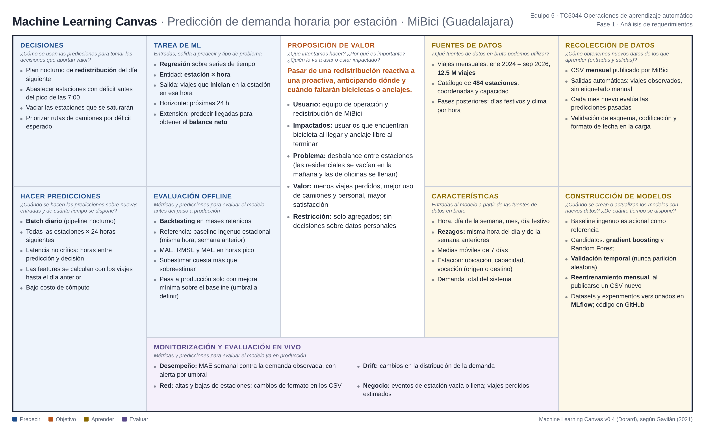

# Machine Learning Canvas: Predicción de demanda horaria por estación (MiBici)

**Equipo 5 · TC5044 Operaciones de aprendizaje automático · Fase 1, Análisis de requerimientos**

Machine Learning Canvas v0.4 (Dorard), según Gavilán (2021).

---

## Objetivo

### Proposición de valor
*¿Qué intentamos hacer? ¿Por qué es importante? ¿Quién lo va a usar o estar impactado?*

**Pasar de una redistribución reactiva a una proactiva, anticipando dónde y cuándo faltarán bicicletas o anclajes.**

- **Usuario:** equipo de operación y redistribución de MiBici.
- **Impactados:** usuarios que encuentran bicicleta al llegar y anclaje libre al terminar.
- **Problema:** desbalance entre estaciones (las residenciales se vacían en la mañana y las de oficinas se llenan).
- **Valor:** menos viajes perdidos, mejor uso de camiones y personal, mayor satisfacción.
- **Restricción:** solo agregados; sin decisiones sobre datos personales.

## Predecir

### Decisiones
*¿Cómo se usan las predicciones para tomar las decisiones que aportan valor?*

- Plan nocturno de **redistribución** del día siguiente.
- Abastecer estaciones con déficit antes del pico de las 7:00.
- Vaciar las estaciones que se saturarán.
- Priorizar rutas de camiones por déficit esperado.

### Tarea de ML
*Entradas, salida a predecir y tipo de problema.*

- **Regresión** sobre series de tiempo.
- Entidad: **estación × hora**.
- Salida: viajes que **inician** en la estación en esa hora.
- Horizonte: próximas 24 h.
- Extensión: predecir llegadas para obtener el **balance neto**.

### Hacer predicciones
*¿Cuándo se hacen las predicciones sobre nuevas entradas y de cuánto tiempo se dispone?*

- **Batch diario** (pipeline nocturno).
- Todas las estaciones × 24 horas siguientes.
- Latencia no crítica: horas entre predicción y decisión.
- Las features se calculan con los viajes hasta el día anterior.
- Bajo costo de cómputo.

### Evaluación offline
*Métricas y predicciones para evaluar el modelo antes del paso a producción.*

- **Backtesting** en meses retenidos.
- Referencia: baseline ingenuo estacional (misma hora, semana anterior).
- MAE, RMSE y MAE en horas pico.
- Subestimar cuesta más que sobreestimar.
- Pasa a producción solo con mejora mínima sobre el baseline (umbral a definir).

## Aprender

### Fuentes de datos
*¿Qué fuentes de datos en bruto podemos utilizar?*

- Viajes mensuales: ene 2024 – sep 2026, **12.5 M viajes**.
- Catálogo de **484 estaciones**: coordenadas y capacidad.
- Fases posteriores: días festivos y clima por hora.

### Recolección de datos
*¿Cómo obtenemos nuevos datos de los que aprender (entradas y salidas)?*

- CSV **mensual** publicado por MiBici.
- Salidas automáticas: viajes observados, sin etiquetado manual.
- Cada mes nuevo evalúa las predicciones pasadas.
- Validación de esquema, codificación y formato de fecha en la carga.

### Características
*Entradas al modelo a partir de las fuentes de datos en bruto.*

- Hora, día de la semana, mes, día festivo.
- **Rezagos:** misma hora del día y de la semana anteriores.
- Medias móviles de 7 días.
- Estación: ubicación, capacidad, vocación (origen o destino).
- Demanda total del sistema.

### Construcción de modelos
*¿Cuándo se crean o actualizan los modelos con nuevos datos? ¿De cuánto tiempo se dispone?*

- Baseline ingenuo estacional como referencia.
- Candidatos: **gradient boosting** y Random Forest.
- **Validación temporal** (nunca partición aleatoria).
- **Reentrenamiento mensual**, al publicarse un CSV nuevo.
- Datasets y experimentos versionados en **MLflow**; código en GitHub.

## Evaluar

### Monitorización y evaluación en vivo
*Métricas y predicciones para evaluar el modelo ya en producción.*

- **Desempeño:** MAE semanal contra la demanda observada, con alerta por umbral.
- **Drift:** cambios en la distribución de la demanda.
- **Red:** altas y bajas de estaciones; cambios de formato en los CSV.
- **Negocio:** eventos de estación vacía o llena; viajes perdidos estimados.

---

### Referencias

- Dorard, L. (s. f.). *The Machine Learning Canvas*. https://www.machinelearningcanvas.com/
- Gavilán, I. G. R. (2021, 30 de junio). *Metodología para Machine Learning (II): Machine Learning Canvas*. https://ignaciogavilan.com/metodologia-para-machine-learning-ii-machine-learning-canvas/
- MiBici. (2026). *Datos abiertos*. https://mibici.net/en/open-data/
